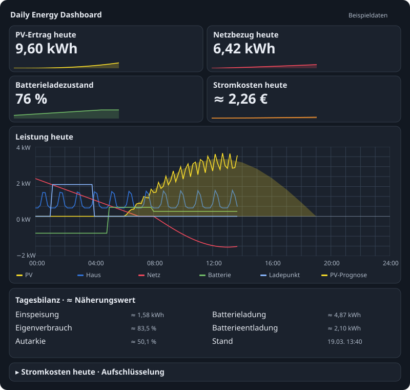

# Energiedashboard für Home Assistant

[English](README.md)

Eine konfigurierbare Karte für PV-Ertrag, Netzbezug, Batterieladezustand, Momentanleistung und geschätzte Stromkosten. Karte und Editor übernehmen automatisch die Sprache aus dem Home-Assistant-Profil. Unterstützt werden Deutsch und Englisch. Bei anderen Sprachen erscheint Englisch.

## Installation

Installiere **Daily Energy Dashboard** im Home Assistant Marketplace als Dashboard-Inhalt. Solange die Karte noch nicht im Katalog gelistet ist, wähle **Über Link hinzufügen**, gib die öffentliche Repository-URL ein und wähle **Dashboard**. Lade anschließend Home Assistant im Browser neu und öffne **Karte hinzufügen → Daily Energy Dashboard**.

Für eine manuelle Installation kopiere die Release-Datei `daily-energy-dashboard-card.js` nach `www` und registriere `/local/daily-energy-dashboard-card.js` unter **Einstellungen → Dashboards → Ressourcen** als JavaScript-Modul. Für eine Darstellung über die volle Breite eignet sich die Panel-Ansicht.

## Einrichtung

Der Kartentitel ist optional. Bei leerem Feld erscheint **Daily Energy Dashboard**.

- Wähle kumulative Energiezähler in Wh, kWh oder MWh. Verwende getrennte, aufwärts zählende Werte für Netzbezug, Einspeisung, Batterieladung und Batterieentladung.
- Leistungssensoren können W, kW oder MW liefern. Der Batterieladezustand wird in Prozent erwartet. Für die Kurven muss der Recorder die ausgewählten Entitäten erfassen.
- Netzleistung ist bei Bezug positiv und bei Einspeisung negativ. Batterieleistung ist bei Entladung positiv und bei Ladung negativ. PV-Erzeugung, Hausverbrauch und Ladeleistung sind positiv.
- Optional kannst du eine Forecast.Solar-Installation auswählen. Sie muss die Aktion `forecast_solar.get_forecast` bereitstellen. Die Prognosefläche endet an der Nulllinie.
- Gib Arbeitspreise und Einspeisevergütung in Eurocent pro kWh und den Grundpreis in Eurocent pro Tag an. Gleiche Start- und Endzeit bedeuten einen ganztägigen Standardtarif. Ein Nebentarif darf über Mitternacht laufen. Nicht benötigte Preise kannst du auf 0 setzen.
- Die Tageskosten sind eine Schätzung auf Basis der aufgezeichneten Zähleränderungen. An Tarifgrenzen werden Änderungen zeitanteilig aufgeteilt.

Voraussetzung ist Home Assistant 2026.11 oder neuer. Die Karte hat keine externen Laufzeitabhängigkeiten.

## Unterstützung

Wenn dir die Karte gefällt, kannst du dich [mit einer Spende per PayPal bedanken](https://paypal.me/mrtnbt).

[MIT-Lizenz](LICENSE)
