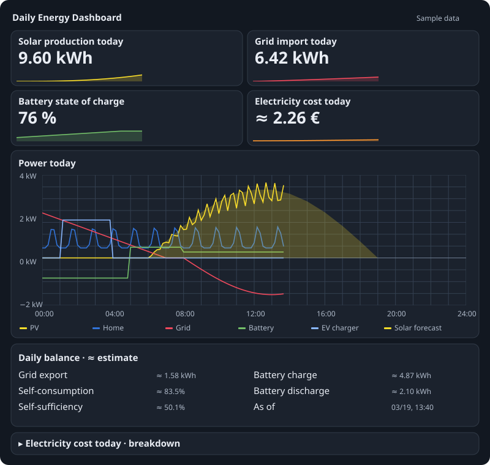

# Daily Energy Dashboard

[Deutsch](README.de.md)

A configurable Home Assistant dashboard card for daily solar production, grid import, battery charge, instantaneous power and estimated electricity cost. The card and its visual editor follow the language selected in your Home Assistant profile. German and English are supported. Other languages fall back to English.

## Install

In Home Assistant Marketplace, install **Daily Energy Dashboard** as dashboard content. If it is not listed in the catalog, use **Add from link** with the public repository URL and select **Dashboard**. Reload the frontend, then choose **Add card → Daily Energy Dashboard**.

For manual installation, place the release asset `daily-energy-dashboard-card.js` in your Home Assistant `www` directory and register `/local/daily-energy-dashboard-card.js` as a JavaScript module under **Settings → Dashboards → Resources**. Use a panel view for a full-width card.

## Configure

The card title is optional. Leave it empty to display **Daily Energy Dashboard**.

- Choose cumulative meters in Wh, kWh or MWh. Use separate increasing totals for import, export, battery charge and battery discharge.
- Select power sensors in W, kW or MW and battery state of charge in percent. Enable Recorder history for the selected entities to display their charts.
- Use positive grid power for import and negative for export. Use positive battery power for discharge and negative for charging. Solar generation, home consumption and EV charging are positive.
- Optionally choose a Forecast.Solar installation. It must provide the `forecast_solar.get_forecast` action. The forecast appears above the zero line.
- Enter prices and export credit in euro cents per kWh and the fixed charge in euro cents per day. Equal off-peak start and end times enable a flat standard rate. Off-peak periods can span midnight. Enter 0 for unused prices.
- The daily cost is an estimate based on recorded meter changes. Changes spanning a tariff boundary are allocated in proportion to time.

Requires Home Assistant 2026.11 or newer. The card has no external runtime dependencies.

## Support

If the card is useful to you, you can [say thanks with a donation via PayPal](https://paypal.me/mrtnbt).

[MIT license](LICENSE)
